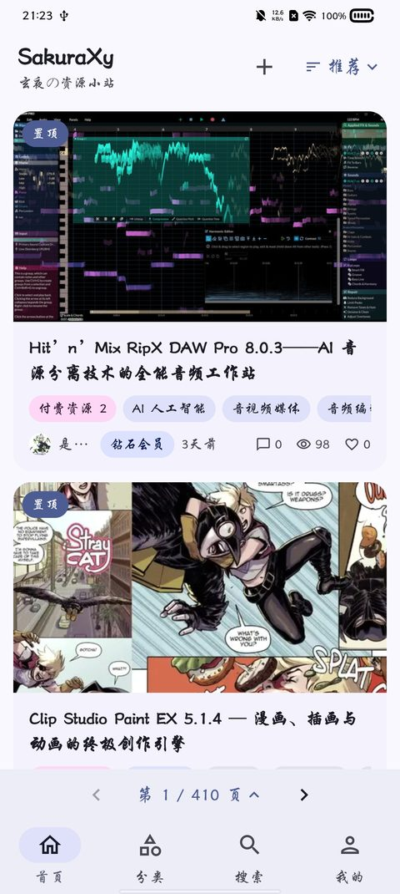
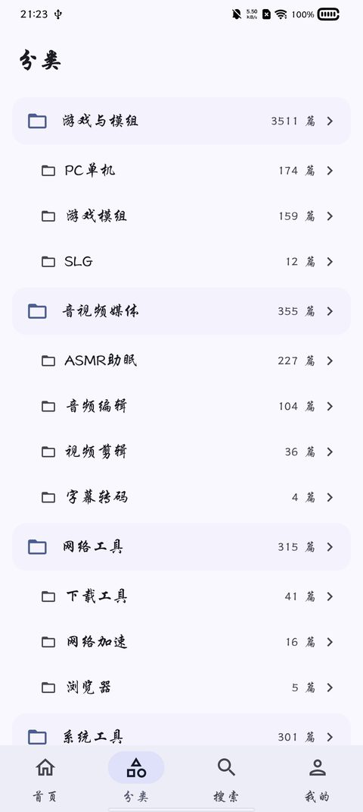
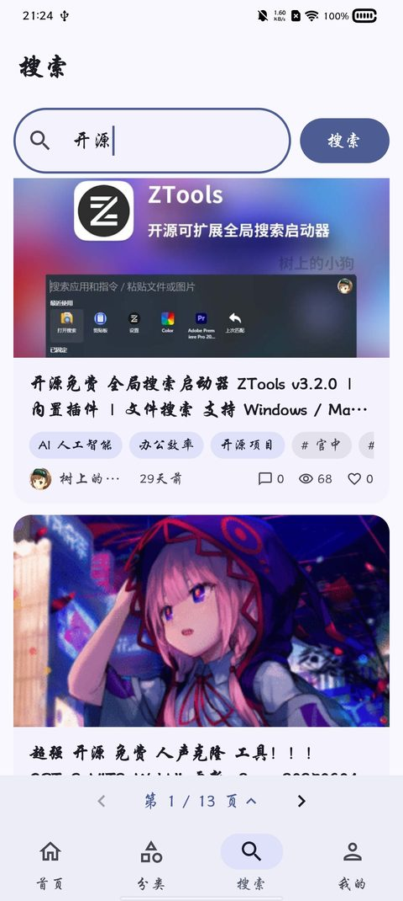
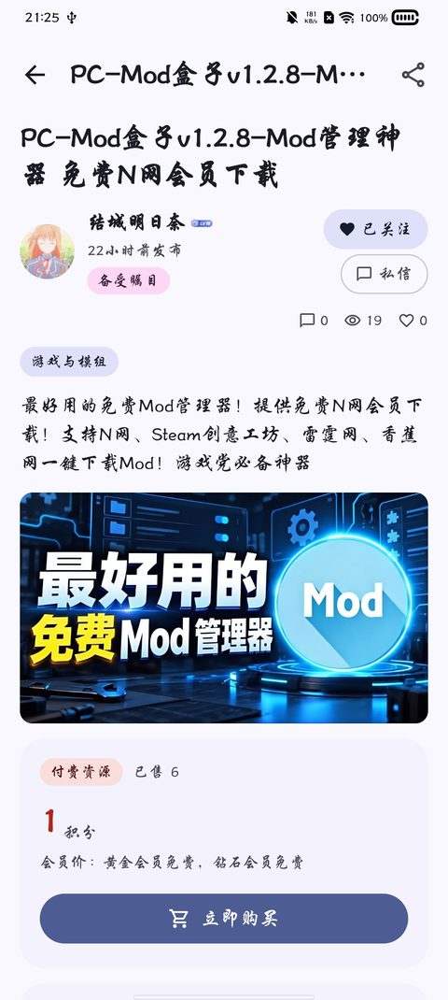
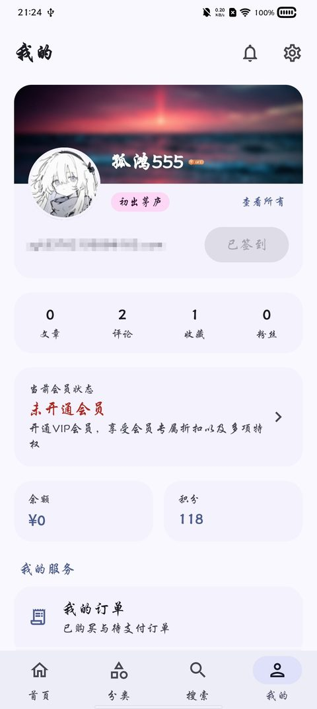
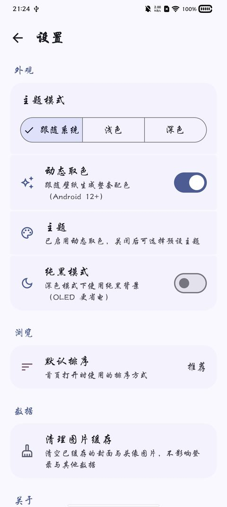

# SakuraXy · sakuraxy.top 第三方安卓客户端

[sakuraxy.top](https://sakuraxy.top)（玄夜の资源小站，WordPress + zibll 主题）的非官方安卓客户端。
用 Kotlin + Jetpack Compose 写成，目标是把网页端的完整体验搬到手机上：浏览、搜索、看详情、
登录、签到、收藏评论、积分购买、拿网盘链接——手机上单手就能走完，不用再开浏览器翻页面。

> **非官方项目**：本项目与 sakuraxy.top 站方无任何隶属关系，只是站点的第三方客户端。
> 使用前请自备站点账号，并遵守站点自身的用户协议。

## 截图

| 首页 | 分类 | 搜索 |
|:---:|:---:|:---:|
|  |  |  |
| 资源卡片流，排序 / 分页条常驻 | 二级分类树，含篇数统计 | 关键词搜索，与网页同源 |

| 文章详情 | 我的 | 设置 |
|:---:|:---:|:---:|
|  |  |  |
| 作者行 / 点赞收藏 / 评分 / 评论区 / 付费区 | 用户中心：签到、会员、积分、订单… | 五套主题 + 动态取色 + 深浅三态 + 纯黑模式 |

## 功能

**浏览**

- 首页资源列表：封面、徽章、标题、分类标签、作者、时间、评论 / 浏览 / 点赞数
- 二级分类（含多级嵌套）、标签归档页、关键词搜索
- 排序：更新 / 发布 / 浏览 / 点赞 / 评论 / 收藏 / 售价 / 积分 / 销量 / 随机
- 分页：列表底部常驻翻页条（页码格子直接选页），列表末尾同时支持「加载更多」

**文章详情**

- 正文完整排版渲染，正文内链可在站内跳转，图片可点击全屏查看（双指缩放 / 双击放大）、长按保存到相册
- 头部：作者行（关注 / 私信）、计数行、面包屑、标签
- 互动：点赞、收藏、分享（系统面板）、文章评分（平均分 / 分布 / 打分）
- 评论：完整评论列表、发表 / 回复 / 评论点赞
- 下载：解析站点 golink 得到真实网盘链接，可复制或交给浏览器打开
- 付费区：显示价格、销量与已购状态；积分购买走收银台确认框、真实扣积分后显示网盘链接；
  付费图片型资源（如云盘二维码截图）支持全屏查看 + **本机离线二维码识别**，解出的链接可复制
- 真钱支付不代付：只提示「请到网站操作」——客户端不经手任何资金

**用户中心**

- 总览 / 资料编辑（头像、封面）/ 签到 / 资产 / 等级 / 会员 / 认证 / 订单 / 打赏
- 账户安全：改邮箱（两步验证）、改密码、重置密码、社交绑定
- 投稿：存草稿、提交审核；消息中心（未读 / 评论 / 点赞 / 私信 / 系统）；私信收发
- 徽章墙：全量徽章展示（已获得彩色 / 未获得灰显）
- 作者页：文章 / 评论 / 收藏 / 粉丝四个标签 + 关注

**登录与账号**

- 账号密码直登，**滑块验证按网页流程原生复刻**（App 内拼图真实拖动，不伪造、不绕过）
- 注册（邮箱验证码 + 滑块 + 用户协议）、找回密码——均复刻站点官方流程
- 站点开启「注册后自动登录」时如实处理登录态

**外观**

- Material 3 Expressive 设计，五套自研主题 + 动态取色（Android 12+）+ 深浅三态 + 纯黑模式
- 透明融合顶栏、底部分页导航栏

## 技术栈

| 层面 | 选型 |
|---|---|
| 语言 / 界面 | Kotlin 2.3 · Jetpack Compose（Material 3） |
| 架构 | `core`（纯 Kotlin JVM 接口层，可离线单测）+ `app`（安卓界面）双模块 |
| 网络 | OkHttp + 会话 Cookie 保持；REST（`/wp-json/wp/v2/…`）+ HTML 页面解析（Jsoup）双通道 |
| 序列化 | kotlinx.serialization |
| 图片 | Coil 3（含 SVG，用于徽章素材） |
| 二维码 | zxing（core 模块内离线解码，识别付费图片资源里的网盘二维码） |
| 存储 | DataStore Preferences（设置与会话快照） |
| 构建 | Gradle 9 · AGP 9 · JDK 21 · minSdk 26 |

站点是 WordPress + zibll 主题，很多数据（封面、徽章、售价、分页、评论区）只存在于
服务端渲染的 HTML 里，所以 `core` 里的数据层是「REST 拿结构化数据 + Jsoup 解析页面拿主题数据」
的双通道设计，解析器全部配有从真实页面脱敏而来的 fixture 样本做离线单测。

## 项目结构

```
saku/
├── core/                    # 纯 Kotlin JVM 接口层（不依赖 Android，全部可离线单测）
│   └── src/main/kotlin/top/sakuraxy/client/core/
│       ├── SakuClient.kt    # 入口：组装 HTTP、会话、各 API
│       ├── Session.kt       # 登录态 / Cookie / nonce 缓存
│       ├── SiteApi.kt       # 列表、分类、搜索、排序（REST + HTML 解析）
│       ├── PostDetail.kt    # 详情页解析（付费区、下载、标签、评分…）
│       ├── SliderCaptcha.kt # 滑块验证流程复刻
│       ├── AuthApi.kt       # 登录 / 注册 / 找回密码
│       ├── UserCenterApi.kt # 用户中心各写操作（签到、资料、投稿、私信…）
│       └── QrDecoder.kt     # 二维码离线解码（多趟策略）
├── app/                     # 安卓界面（Compose）
│   └── src/main/java/top/sakuraxy/client/
│       ├── ui/              # 各页面 + 主题（home/category/search/detail/profile/user/settings…）
│       └── data/            # 设置存储、会话落盘、分享/保存图片等系统能力
└── docs/
    ├── devlog/              # 开发日志（按天记录实现内容与实测证据）
    └── screenshots/         # 界面截图
```

## 构建

需要 JDK 21 与 Android SDK（`minSdk 26`）。在项目根目录建 `local.properties` 指向 SDK：

```properties
sdk.dir=/path/to/AndroidSdk
```

常用命令：

```bash
./gradlew :core:test                 # 接口层离线单测
./gradlew :app:testDebugUnitTest     # 界面层单测
./gradlew :app:assembleDebug         # 出 debug APK
```

APK 产物在 `app/build/outputs/apk/debug/app-debug.apk`。

## 设计原则与红线

这个项目从第一天起就给自己划了几条不能碰的线，也写在代码与解析逻辑里：

- **不绕过任何门禁**：不绕过付费、积分、登录或任何权限限制。客户端能看到什么，完全等同
  于用户在网页上登录自己账号后能看到什么，一切如实呈现。
- **付费类不代付**：积分购买复刻站点官方请求（失败如实报错）；真钱支付只提示「请到网站操作」，
  客户端不经手资金、不伪造支付状态。
- **写操作照官方流程**：签到、点赞、评论、投稿等只复刻站点官方请求；滑块验证数据只来自
  用户的真实拖动，不伪造对齐、不试探容差。
- **请求克制**：不做全站批量抓取、批量下载、离线镜像。

## 已知限制

- 站点的页面结构（zibll 主题）或接口一旦改版，依赖 HTML 解析的功能（封面、售价、下载链、
  评论、付费区等）可能失效；解析层尽量做了兜底与降级（例如付费图片型判定失败时只是不显示图库，
  不影响其他内容），但仍可能随站点更新而需要跟进适配。
- 站点侧偶发响应较慢，详情页解析超时已内置重试。
- 目前只适配 sakuraxy.top 这一套站点配置（WordPress + zibll v9.x），未做通用化。

## 许可证

本项目以 [MIT 许可证](LICENSE) 开源，Copyright (c) 2026 Xinghongia。

第三方依赖各自的许可证见各依赖项目（OkHttp、Jsoup、Coil、zxing、AndroidX 等）。
项目图标暂用系统默认，应用名「SakuraXy」为占位。

## 致谢

- 站点 [sakuraxy.top](https://sakuraxy.top) 与其使用的 zibll 主题
